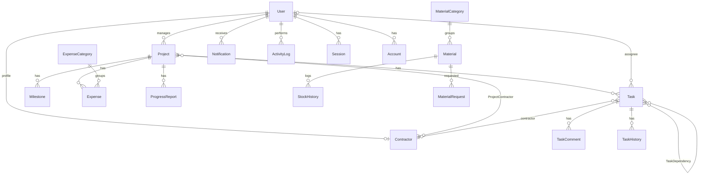

# Database design

Key rules: unique `User.email`, `Material.sku`; composite keys on `ProjectContractor` and `TaskDependency`; indexes on `Task(projectId,status)`, `Task(deadline)`, `Expense(projectId)`, `Expense(date)`.
